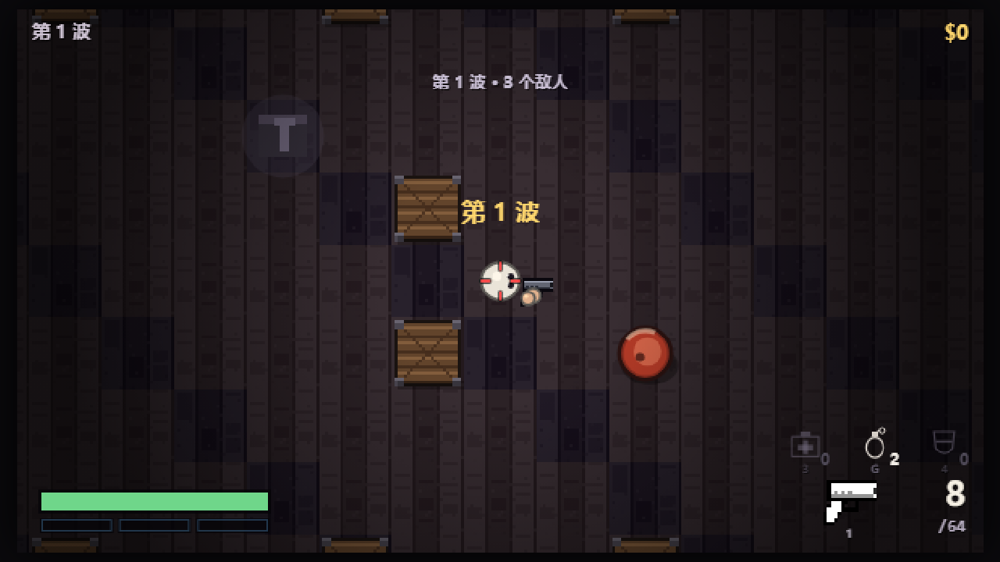

# HOTLINE 2.5D — 俯视角一击必杀框架

一个《迈阿密热线》式的俯视角动作游戏（HTML5 / Canvas 2D，纯浏览器运行）。
不做剧情、不做美术风格，只把**手感与循环**搭好：一击必杀、武器即资源、声音即情报、死亡即重来。

> 早期有一个 Godot 4.6 实现，已于 2026-11-01 废弃，本仓库只保留 H5 版。

---

## 运行

**双击 `web/index.html` 就能玩**，零依赖、零构建、不用装任何引擎。

线上版：`https://zh1chuan9.github.io/hotline/`（GitHub Pages）。

| 方式 | 说明 |
|---|---|
| 本地 | 双击 `web/index.html`，或用任意静态服务器托管 `web/` 目录 |
| 线上 | 推送到 `main` 分支后，GitHub Actions 自动部署 `web/` 到 Pages |

### 回归测试

改完核心逻辑想确认没崩，跑一遍冒烟测试（无头 Edge 即可，不用开浏览器）：

```bash
# 无头 Edge 直接跑测试页，看结果是否「全部通过」
"/c/Program Files (x86)/Microsoft/Edge/Application/msedge.exe" --headless=new \
  --disable-gpu --virtual-time-budget=8000 --dump-dom \
  "file:///D:/Games/2.5d/web/test.html" | grep RESULT
```

测试覆盖：开局发枪、备弹换弹、击杀计分、商店、副武器槽、快手技能、散弹枪逐发装填、升级站、换枪动画等。



### 玩法：波次生存（类 COD 僵尸 / PvE）

玩家出生在地图中央，敌人从四角刷怪点一波波涌来。击杀攒钱（$），到地图上的**补给点**按 `B`
买武器/弹药/护甲/血包，或玩**老虎机**摇技能，然后打下一波。**波次无限递增**，敌人越往后
越多、越硬、越快，枪手和霰弹兵比例也越来越高，直到你被打死——比谁撑得更久。

**单血量 + 三格护甲**（参考《使命召唤》要塞护甲板，替代原来的六部位肢体损伤）：

| 系统 | 数值 | 机制 |
|---|---|---|
| 血量 | 上限 100 | 受击先扣护甲，护甲耗尽才掉血 |
| 护甲 | 三格，每格 50（共 150） | 护甲板按 4 取出、长按左键 1 秒装入，或老虎机摇「铁甲」补满 |
| 敌人血量 | 近战 24 / 枪手 20 / 霰弹兵 26 | 大幅降低，手枪两枪一个近战兵 |

**补给点**（走近按 `B` 才开，不再是波次间隙自动弹出）：

| 商品 | 价格 | 效果 |
|---|---|---|
| 手枪 / 匕首 / 棒球棍 / 霰弹枪 / 冲锋枪 | 0 / 50 / 100 / 300 / 400 | 换武器（旧武器掉地上） |
| 弹药 | 120 | 补满当前武器备弹 |
| 护甲板 | 250 | 进背包，按 4 取出长按左键 1 秒装一块（一格 50） |
| 血包 | 150 | 回满血量 |
| 老虎机 | 200 | 摇一次，三同图案得技能 |

**老虎机**是技能的唯一来源：三个转轮，摇出三个相同图案才发奖。图案有疾跑（移速）、
快枪手（射速）、快手（换弹）、铁甲（补满护甲）、双倍分（3 波双倍的钱）。

技能可叠加，每层效果与封顶：

| 技能 | 每层 | 满层封顶 |
|---|---|---|
| 疾跑 | 移速 +12% | +60%（5 层） |
| 快枪手 | 射击间隔 -10% | -55%（6 层） |
| 快手 | 换弹时间 -15% | -60%（4 层） |
| 铁甲 | 护甲直接补满 | 一次性效果，不叠加 |
| 双倍分 | 3 波双倍收入 | 重复命中重新计 3 波（不累加） |

**保底机制**：连着空转 5 次之后，第 6 次**必出三同**（界面顶部有 `保底 n/5` 进度条，攒满会变绿）；
摇出两个相同时退回 `$40` 安慰金，不至于 200 块全打水漂。

**备弹系统**：弹匣和备弹分开，换弹从备弹取。换弹有动画（见下），**动画期间打不出子弹**。

> 枪械**出厂属性刻意压得很低**（伤害、弹匣、射程都偏低），要靠第 5 波后开放的**武器升级站**补回来。

| 武器 | 弹匣 | 备弹上限 | 特点 |
|---|---|---|---|
| 手枪 | 8 | 64 | 精准、半自动 |
| 霰弹枪 | 4 | 24 | 近距离喷子，溅血最多，逐发装填 |
| 冲锋枪 | 14 | 84 | 全自动，后坐力大、散射严重、射程短 |

敌人死亡有概率掉落血包（15%）和子弹（25%），**走近自动拾取**（手里有枪也会捡，地上的枪不会挡住
血包；空手时不会去捡地上的枪，得按 `E`）。血包拾取后攒进背包，按 `3` 取出、长按左键 **2 秒**读条回
50 血（消耗一个血包，按 `1` 收起来）。

护甲板同理：补给点买进背包，按 `4` 取出一块、长按左键 **1 秒**装一格护甲（+50），按 `1` 收起来。
判定"甲满"只看护甲值（150），不看剩余格数 —— 所以插着三格板但被打到只剩 60 点时，照样能再装一块补上去。

**取出血包 / 护甲板时，角色手上会真的捧着那个东西，枪收起来**；同时准心变成空心圆，并跟着读条
慢慢填满一圈（治疗是绿色、装护甲是蓝色）。**换弹也是同一个空心圆**（琥珀色），圆圈一圈走完就是
装好子弹，不用再盯着 HUD 上的小字。

**爆头**（参考《逃离塔科夫》的"瞄哪打哪"）：准心压在敌人头上时准心会变成橙色并多一个细圈提示，
这一枪就是爆头 —— 伤害 ×2.6、钱 ×1.8，血溅得也更多。近战挥击同样可以爆头（倍率 1.6）。

**开局先有 30 秒准备时间**（场上没有敌人，可以先去补给点摸清位置、备点家伙），按空格直接开打。
每清完一波，同样进入 **30 秒整备时间**，可自由走动、去补给点买装备，按空格或回车跳过直接进下一波。

地图是 ASCII 字符图，在 `web/js/game.js` 的 `ARENA` 里改：

```
# 墙    . 地板    o 掩体（木箱）    P 玩家出生点    M 刷怪点    S 补给点    U 武器升级站
```

波次敌人由 `startWave()` 按刷怪点动态生成，`M` 字符就是刷怪点位置（四角各一个），
`S` 是补给点（左右各两个，走近按 `B` 补给），`U` 是武器升级站（地图正中，第 5 波后走近按 `V`）。地图已无门，掩体 `o` 是主要战术遮蔽。

### 血迹按武器分档

打死人溅多少血，由**打死他的那把枪**决定（`WEAPONS[x].blood`）：

| 武器 | 血泊 | 拖拽血痕 | 空中血珠 | 地面碎血点 |
|---|---|---|---|---|
| 手枪 | 1 | 1 | 10 | 12 |
| 匕首 | 2 | 2 | 13 | 16 |
| 冲锋枪 | 2 | 2 | 16 | 20 |
| 棒球棍 | 3 | 2 | 18 | 24 |
| 霰弹枪 | 7 | 5 | 34 | 46 |

血泊贴图的旋转、拉扁比例、大小、透明度、飞溅方向都是随机的，并且 alpha 只给 0.58~0.8——
地板纹理要透出来，多滩叠在一起自然变深，才不会糊成一坨死红。每层贴花上限 420 处。

**H5 版的相机：玩家在中心，准心负责"让位"**

- 相机目标 = 玩家位置 + 准心前探，再交给一根**临界阻尼弹簧**（`ω = 18`，约 0.2 秒到位，不过冲、不抖）
- 前探量由**准心在屏幕上的比例位置**算，不是"鼠标世界坐标 − 玩家"。后者是个正反馈环：相机一动，鼠标的世界坐标跟着动，前探量又被推大，鼠标明明没动画面也会一直朝准心方向漂
- 屏幕中心 ±14% 是死区（`CAM_DEAD`），微调瞄准时画面纹丝不动；出了死区走 smoothstep，最多让位 56 × 38 世界像素（视野 320×180 的约 1/6）。准心推到右边 → 画面右移 → 玩家被顶到左边，等于"往那边看"，但玩家永远留在画面里
- 相机允许越出地图 `CAM_PAD = 220`：地图外圈本来就是墙，外面继续平铺墙砖就是"更厚的楼体"，所以贴边站也不会把前探 clamp 掉，也不会露黑边
- 准心跟着鼠标走，画在屏幕空间（不跟世界缩放走，抬枪时才能收拢）；系统光标不隐藏
- **抬枪 = 画面拉远 + 前探猛推**：`zoom` 2 → **1.5**（视野 320 → **427** 世界像素，比腰射还宽 33%），
  前探同时乘到 3 倍，被 `AIM_EDGE_X / AIM_EDGE_Y` 卡在"玩家刚好还留在画面里"的位置（实测 56 → **163** 世界像素）。
  两个加起来，准心能落到玩家前方 **376** 世界像素处（腰射只有 215），也就是"站着不动能看到一整个房间远"。
  抬枪时边缘暗角也压淡 45%，免得那圈黑盖住正想看的地方
  （`AIM_ZOOM_MUL / AIM_PAN_MUL / AIM_EDGE_X / AIM_EDGE_Y / AIM_IN / AIM_OUT / HIP_SPREAD_MUL / AIM_SPREAD_MUL / AIM_MOVE_MUL`）

> 曾经试过"相机锁准心"（准心恒在屏幕正中、相机中心 = 准心）：鼠标一动整幅画面就挪，鼠标垫不够用、贴边顶死，已回退。
> 现在的做法是"玩家仍是画面主体，准心只负责把画面往那边推一点点"。
> 手感常量都在 `web/js/game.js` 的 `CAM_PAN_X / CAM_PAN_Y / CAM_DEAD / CAM_OMEGA / CAM_ZETA / CAM_PAD` 一行里。

### 敌人 AI：看得见就压，看不见就绕

- **移速整体放慢**（近战 76 / 枪手 62 / 霰弹兵 68，只有玩家的 57%/46%/51%），波次成长也更缓（每波 +2.2%，上限 +20%），
  玩家有空间拉枪线、而不是被贴脸
- **看得见玩家**（视野锥内 + 视线不被墙/掩体挡住 + 反应延迟）：近战带着轻微摇摆扑上来（不做直线靶子），
  枪手保持 140px 的"甜点距离"，太近后退、太远压上，并**绕圈侧移**（方向保持 0.7~2 秒再翻，不左右乱抖）
- **同伴分离**：离得小于 30px 的敌人会互相推开，一窝蜂叠在一起像一个人，散开才有包抄感
- **不误伤同伴**：枪线 110px 内有自己人就先不开枪，压 0.28 秒冷却换个角度再打
- **看不见**（刚脱战 / 听到枪声）：走 A\* 到"最后看到玩家的位置"或声源，而不是对着墙撞
- A\* 跑在 24px 的格子网格上（一层 25×15 = 375 格）；open 表用线性扫描选最小 f，一次最多展开几十个节点，不值得上二叉堆
- 路径出来是直角台阶，用视线检测做**拉直**（string pulling），走起来是贴墙的斜线
- 路径每 0.35~0.6 秒重算一次，目标挪远了（>44px）也会立刻重算

调试参数：

- `index.html?autostart=1` — 跳过标题直接进第一波（默认跳过 30 秒准备期）
- `index.html?autostart=1&prep=1` — 保留开局 30 秒准备期（截图核对倒计时用）
- `index.html?autostart=1&gun=smg` — 手上直接塞一把武器（pistol/smg/shotgun/bat/knife）
- `index.html?autostart=1&gun=smg&side=shotgun` — 再给背上塞一把副武器
- `index.html?autostart=1&peek=1` — 出生点挪到第一个敌人旁边（看战斗区域）
- `index.html?autostart=1&shop=1` — 直接打开商店界面（截图用）
- `index.html?autostart=1&upgrade=1` — 直接打开武器升级站（截图用，自动解锁并给钱）
- `index.html?autostart=1&heal=0.55` — 摆出"正在治疗、读条 55%"的状态（截图用，会自动冻结）
- `index.html?autostart=1&plate=0.45` — 摆出"正在装护甲板、读条 45%"的状态（截图用）
- `index.html?autostart=1&gun=smg&reload=0.6` — 摆出"换弹到 60%"的状态（准心进度环 + 角色换弹姿势 + 半空中的旧弹匣，截图用，会自动冻结）
- `index.html?autostart=1&ammo=4` — 把弹匣压到指定发数（截图核对"按 R 换弹"提示用）
- `index.html?autostart=1&ads=1` — 摆出"抬枪到位"的状态（自动冻结，核对准心收拢 / 画面拉远用；`ads=0` 就是腰射）
- `index.html?autostart=1&at=300,170` — 把玩家直接摆到世界坐标（截图核对相机用）
- `index.html?autostart=1&at=300,170&aim=95,42` — 再把鼠标固定在相对画面中心的偏移处（`aim=0,0` 即贴在正中）

跑 H5 版回归测试（不需要开浏览器窗口）：

```bash
"C:/Program Files (x86)/Microsoft/Edge/Application/msedge.exe" --headless=new --disable-gpu \
  --virtual-time-budget=8000 --dump-dom "file:///D:/Games/2.5d/web/test.html" \
  | sed -n '/<pre id="result"/,/<\/pre>/p' | sed 's/<[^>]*>//g'
```

---

## 操作

| 输入 | 行为 |
|---|---|
| `WASD` / 方向键 | 移动（8 方向） |
| 鼠标 | 瞄准（朝向永远跟随鼠标，所以可以边后退边开枪） |
| 左键 / `J` | 攻击（弹匣打空自动换弹，从备弹取） |
| **右键（按住）** | **瞄准**：画面拉远、视野变宽 + 相机顺着准心方向前探一大截（能看很远），散射从"腰射"收得很紧，准心跟着收拢；端着枪移速只剩 35%（134 → 47 px/s） |
| `E` | 捡 / 换地上的武器（空手时走近自动捡；两个槽都满时按 E 换掉背上的） |
| `R` | 手动换弹 |
| `1` / `2` | 数字键直达：切主武器 / 切副武器（按一下就到位，不来回抖） |
| `B` | 走近补给点后按 B 打开商店 |
| `V` | 走近升级站后按 V 打开升级站（第 5 波后开放） |
| `3` | 取出血包（需背包有血包），长按左键 2 秒治疗；按 `1` 收起 |
| `4` | 取出护甲板（准心变空心圆），长按左键 1 秒装一格；按 `1` 收起 |
| `G` | 扔手雷（朝准心方向，撞墙即爆，**自己站在爆心旁边也会被炸**） |
| `空格` / `回车` | 跳过倒计时：开局准备期按就直接开打，波次整备期间按就进下一波 |
| `ESC` | 暂停 |

死亡后躺 3 秒自动开新局（没有手动重开关卡了）。

**HUD 布局：** 参考使命召唤，两侧都只用图形和数字。

- **左下**：血条 + 三格护甲，不写任何数值；血量低于 35% 时血条外框闪红。治疗 / 装护甲板的读条压在血条上方。
- **右下**：上排是三个消耗品图标（血包 `3` / 手雷 `G` / 护甲板 `4`），图标右下角是持有数量，正下方是按键；
  下排是两把枪——右边大号的是**手上拿着的那把**（亮的，下方标 `1` 或 `2` 表示它所在槽位），
  左边小一号、压暗的是背上那把（标切换到它的按键），再右边是该枪的**大号弹匣内子弹**和 `/ 备弹`。
  没子弹时数字变红；换弹中 `%` 和进度条顶掉备弹显示。
  消耗品为 0 时整个图标压暗，正在使用 / 装配时图标恢复本色并套一圈脉冲。
- **屏幕正下方**：弹匣掉到一半以下才提醒"按 R 换弹"——≤1/2 是琥珀色，≤1/3 转成闪动的红色；
  正在换弹、没有备弹、近战武器、非战斗状态都不显示。
- 武器图标直接用游戏里的武器贴图（`w_pistol` 等）白化而来 —— 去色后提亮压暗部，
  保留原有的部件描边，所以形状就是角色手上那把枪，不用另画一套。
- 左上波次、右上现金、顶部中间出提示、右上现金下方是连击数。

---

## 已实现的核心机制

**单血量 + 三格护甲。** 玩家血量上限 100，三格护甲每格 50 点（参考 COD 要塞护甲板）。受击先扣护甲、护甲耗尽才掉血。敌人血量大幅降低（近战 24 / 枪手 20 / 霰弹兵 26），手枪一枪一个近战兵。

**金钱经济（$）。** 击杀给钱（随波次增长，连击有加成），HUD 右上角显示 `$余额`，到补给点买武器、弹药、护甲板、血包，或玩老虎机。资源管理 + 购物取舍是循环的核心。

**老虎机 = 技能的唯一来源。** 三个转轮摇出三个相同图案才发技能（疾跑/快枪手/快手/铁甲/双倍分），
连着亏 5 次之后第 6 次必中，摇出两个相同还退 $40 安慰金。
除老虎机之外没有任何途径拿技能 —— 想要成长就得花钱赌，钱不够就老老实实打。

**手雷。** 按 `G` 朝准心扔出去，飞 0.85 秒后炸（撞墙撞桶提前炸），半径 76 内按距离衰减
最高 135 伤害，边缘只剩三成。**自己也会被炸**——往脚下扔是要付出代价的。
背包上限 5 颗，商店 $120 两颗，精英必掉。

**油桶。** 地图上固定摆 5 个，被子弹打中（18 点耐久，手枪一枪）或被爆炸波及时会炸，
半径 68、中心 110 伤害。**会连锁**：一只炸开会点燃范围内的其它桶，引信 0.16 秒，
炸完之后那个格子就通了（碰撞和寻路同步移除）。数量太多会变成"随手清场"，所以只放 5 个。

**备弹系统。** 弹匣和备弹分开（手枪 8/64、霰弹枪 4/24、冲锋枪 14/84），按 `R` 换弹（打空也会自动换），换弹从备弹取。敌人概率掉落血包和子弹，**掉枪时自带一份备弹（约 1/3 满额）**，不会捡起来只有两三发。**敌人只掉枪，近战武器（匕首/球棍）不掉**。

**换弹动画。** 换弹不是干等进度条：

- **手枪 / 冲锋枪**：旧弹匣从握把位置甩出去（收窄的小长条，侧向飞出、旋转、淡出），伴随着一声干涩的"哐"；然后整把枪连同两只手往回收、侧倾、抖动，模拟"拔弹匣→塞弹匣→拍上"；
- **霰弹枪**：**逐发装填**，不甩弹匣——每塞一发"咔"一声，一发一发塞进枪管，塞满即止；换弹总时长 = 每发 0.42 秒 × 缺的发数；**空弹壳在开火那一下就已经退掉了**（打一发退一颗红色小壳、"叮"一声），所以上单装填时不再退壳；
- 换弹走完"咔"一声上膛，机匣位置崩两点火星；
- **整个动画期间扣不动扳机**（`p.reload > 0` 时 `playerAttack` 直接返回，`p.cooldown` 也压着换弹时长，双重保险），打空自动换弹和按 `R` 手动换弹走同一套动画。

**换枪动画。** 按 `Q` / 数字键切枪不是瞬间完成的——每把枪有各自的**掏枪时间**（手枪 0.22s、冲锋枪 0.34s、霰弹枪 0.46s、匕首 0.16s、球棍 0.26s），枪往回收再端出来，**期间扣不动扳机**。

**武器升级站。** 第 5 波清完之后解锁（地图正中的 `U`，走近按 `V`）。四条线各 3 级，越升越贵：

| 升级线 | 每级 | 说明 |
|---|---|---|
| 伤害 | +22% | 直接加子弹伤害 |
| 弹匣 | +30% | 弹匣容量变大 |
| 射程 | +22% | 子弹飞得更远 |
| 红外激光 | 散布 −14% | 腰射/瞄准都更收 |

四条线全满后开放**进化**（$1800 起）：

- 手枪 → **双枪**（左右开弓，一次两发，弹匣翻倍）
- 冲锋枪 → **双持**（两把一起泼，一次两发，弹匣翻倍）
- 霰弹枪 → **半自动**（射速 0.75s → 0.30s，按住连发）

升级按**枪种**记账（不跟着某一把枪走），捡到同型号枪自动继承；未持有的枪也能先升级，捡到后直接生效。升级站里 A/D 换枪、W/S 换项、回车购买、V/ESC 退出。

**主武器 + 副武器。** 手上拿一把、背上背一把（`Q` 切换），所以能多捡一把枪。捡起跟自己已有武器**同型号**的枪时，不占槽位，直接并成那把枪的备弹（枪里剩多少给多少）；两个槽都满了再按 `E` 才换掉背上的，被换掉的旧枪原地掉回地上。

**瞄准（ADS）。** 按住右键抬枪，0.09 秒到位：

| | 腰射（不按右键） | 瞄准（按住右键） |
|---|---|---|
| 散射 | 武器基础值 ×2.2（冲锋枪 17.6°、霰弹枪 19.8°） | ×0.3（冲锋枪 2.4°、手枪 0.48°） |
| 准心 | 四道刻线张到 20~26px | 收到 3~5px，正中补一颗点 |
| 画面 | 2× 缩放，视野 320×180 | **1.5× 缩放，视野 427×240**（不缩反宽），前探 56 → 163 世界像素 |
| 最远可视 | 玩家前方约 215 世界像素 | 玩家前方约 **376** 世界像素（准心能落到哪儿就看到哪儿） |
| 移速 | 100%（134 px/s） | **35%（47 px/s）** |

手持近战武器、正在用血包 / 装护甲板时按右键不会抬枪。**原来的丢武器系统（右键 / `X`）整个删掉了** —— 右键现在是瞄准。

**爆头。** 准心压在敌人头上就是爆头（参考《逃离塔科夫》"瞄哪打哪"）：伤害 ×2.6、钱 ×1.8，血更多。准心压头时准心变橙色并多一圈细提示。近战也能爆头（×1.6）。

**手持消耗品。** 按 3 取血包 / 按 4 取护甲板时，角色手上真的捧着那件东西（枪收起），准心同时变成空心圆并按读条进度填满（治疗绿、护甲蓝）。

**波次递增。** 敌人数量、血量、速度、枪手/霰弹兵比例随波次上升，无限递增，比谁撑得久。开局 30 秒准备、每清完一波 30 秒整备（都可跳过）再进下一波。

**每 5 波精英。** 第 5/10/15… 波额外刷一只精英：血量是小怪的 6 倍、体型 1.45 倍、脚下有红色脉动光环、头顶带血条，
枪伤 ×1.5，掉的钱 ×3，击杀直接给 1 手雷 + 1 护甲板。波次从"数字在涨"变成"有节点要熬"。

**武器即资源。** 枪有弹匣、有备弹。打空自动换弹，备弹耗尽就空仓。冲锋枪后坐力大、散射严重、射程短，是近距离泼水枪。

**声音即情报。** `emitNoise(位置, 半径)` 是唯一的跨系统情报通道。开枪、推门、挥砍都会广播，把远处的敌人引过来。

**死亡留下痕迹。** 每一具尸体都留在地上（面朝下摊开的姿态，统一外描边），配一滩血和一道甩出去的血痕，血迹按武器分档（霰弹枪一枪喷满屋子，手枪只是一小滩）。

---

## 目录结构

```
web/                        H5 版（唯一实现）
  index.html               入口，双击即玩
  test.html                无头冒烟测试（无头 Edge 可跑）
  js/game.js               全部逻辑：关卡、碰撞、AI、渲染、WebAudio
  assets/sprites/          游戏贴图（地板/墙/掩体/血迹/尸体/武器剪影，27 张 PNG）

.github/workflows/pages.yml  GitHub Pages 自动部署（把 web/ 发布到线上）
```

---

## 美术资源

**活人不用贴图，是画出来的。** 造型只有三样东西：**一个头、两只圆手**。

- 头：头发色的圆 + 一圈深色描边 + 一块很淡的发旋高光
- 手：两个圆，跟着朝向连续转 —— 鼠标指哪，手就在哪。半径 `HAND_R = 2.15`（占头直径约 37%），
  之前 2.9 的时候两只手把枪挡得只剩枪口，现在能完整看到枪身
- **持枪手势**（`GRIP` 表）：手不再绕头对称张开，而是按枪的"握持位"摆
  - 手枪 / 冲锋枪：双手合握在握把（扳机）处，左手包在右手后侧
  - 霰弹枪：右手扣扳机（机匣下沿）、左手前伸托住泵动护木，一前一后拉开
  - 手画在枪**之上**（得压住枪身下沿才像握着），但 y 落在"枪身下沿再往下一点"，
    只盖住握把/护木，不糊住枪管。后坐时手跟枪一起往回缩
  - 近战 / 空手不在 `GRIP` 里，继续走"绕头对称张开 ±33°"的老摆法
- 眼睛：两个深色圆点贴在头的朝向侧，瞳孔再往朝向偏 0.3px，"看向哪"一眼就看出来

这么做的直接好处是**朝向是连续的**。之前走过的弯路：给 8 个方向各画一张 32px 贴图，结果

- 正 90° 俯视下，站着的人和趴着的人的投影**完全一样**（都是"头 + 两肩 + 前伸的双臂"），画多少稿都会被读成"趴着撑起"
- 一旦把躯干、肩膀、腿加上去，32px 里就只剩一团色块：方块躯干读成铠甲，收窄的底部读成盾牌，肩带读成披风
- 8 方向只能吸附，鼠标斜着移的时候手会"跳格"

砍掉躯干之后，信息量只剩"头 / 手 / 眼"，反而每一样都看得清了。代价是角色没有身体，但这套玩法里角色只是一个会动的准星，够用。

配色在 `web/js/game.js` 里按角色给（`PALETTE` 表），玩家白发红衣、兜帽兵紫、枪手灰、霰弹兵土黄。

**尸体、血迹、武器图标等贴图**位于 `web/assets/sprites/`（27 张 PNG）。

- **尸体是独立贴图**（`corpse_*.png`，趴着的姿势），不是把活人转个角度
- **武器图标侧视**，按"枪口 → 枪托"的遮挡顺序画（先画刀身再画护手，护手才不会被盖掉）。持在手里时按 0.72 缩放，否则一把手枪比头还大
  - 手枪 / 冲锋枪 / 近战是 18×18；**霰弹枪单独用 22×18**：泵动喷子的枪管本来就比手枪长一截，
    18 宽塞不下"长枪管 + 管状弹仓 + 木护木"三层关系，画出来会挤成一根灰管。
    绘制时长枪按多出来的宽度自动前移（`gunShift`），枪托位置不变、枪管多伸一截
- **血迹**：4 张血泊 + 2 张血痕。一次死亡铺 1 大滩 + 2 小滩 + 1 道甩痕 + 14 粒血雾。血泊中心最暗（积得最厚），外围一层淡薄膜 —— 反过来做（中心亮）会变成像贴纸的圆点

---

## 设计上的几个选择

**为什么角色用代码创建，而不是贴图？**
活人造型靠 `drawActor()` 直接画（一个头 + 两只圆手 + 眼睛），子类只设配色。好处是新增一种敌人不需要复制贴图，手和眼睛还能逐帧跟着朝向转。

**为什么关卡是 ASCII？**
改一行字符串就能改一个房间，diff 可读，手写速度快，也不用打开编辑器。地图数据就在 `web/js/game.js` 的 `ARENA` 里。

**为什么用 hitscan 而不是子弹节点？**
原版就是瞬间命中。hitscan 没有子弹飞行时间、没有穿透 bug、没有节点池，散布靠多次射线实现（霰弹枪 7 条）。

**为什么音效是算出来的？**
框架阶段不想让你卡在"没有音效素材"上。所有音效都是 WebAudio 振荡器 + 噪声缓冲合成。要换真实音效，只改 `web/js/game.js` 里 `Sfx.play()` 的分支。

---

## 想改什么，改哪里

**加一把武器** → `web/js/game.js` 的 `WEAPONS` 表加一条（含 `dmg`/`mag`/`spread`/`range`/`blood`），商店 `SHOP` 里加一项，`PALETTE` 补配色。

**加一种敌人** → `web/js/game.js` 的 `ENEMY_KIND` 加一种，`PALETTE` 里补一组同色。

**调手感** → 先调这几个数：
- `PLAYER_SPEED`（移动速度）
- `WEAPONS` 各枪的 `fireRate` / `spread` / `shake` / `dmg`
- 敌人各分支的 `reaction` / `aim_error`（敌人有多"讲道理"）
- `FX.hitstop` 的时长（0.045 是"钉一下"，0.08 就变卡了）

---

## 跨局记录与两个启动界面

存档写在 `localStorage` 的 `hotline.save.v1`：挑战模式的上次分数 / 最高分数 / 最高波次，
剧情每关最高分，以及「是否已通关全部关卡」。

- **挑战模式启动页**：标题页点「挑战模式」先进入启动页，展示上次分数、最高分数、最高波次，
  再点「开始游戏」才真正开局（回车/空格也能开，ESC 返回）。死亡或中途返回主菜单时成绩落盘。
- **剧情选关**：只有通关全部 4 关之后，点「剧情模式」才会进入选关页；没通关时保持原来的
  「点一下直接开打」。选关页每关显示历史最高分，另有「从头开始」。

## 剧情模式分数倍率

剧情模式专属（挑战模式的积分 / 连击逻辑保持原样）：击杀把倍率往上推，
普通 +0.2、连击每多一层再加最多 +0.4、爆头 +0.3、**处决额外 +0.5**，上限 x8。
停手 4.5 秒后按每秒 0.9 往回落，直到 x1。倍率直接乘在每次击杀得分上，
右上 HUD 显示 `xN.N` 加一条保持时间条，结算卡片额外列出本关得分与最高倍率。

**处决慢镜**：最后一人补刀瞬间先顿 0.07 秒，再把世界压到 0.3 倍速 0.55 秒，
头飞出去那半秒看得清楚；玩家同时倒下时死亡慢镜优先。

## 手雷抛物线

手雷带离地高度 `z` 和垂直速度：抛出约 0.77 秒落地、最高约 32px，落地弹两下后贴地滑行减速。
地面阴影随高度变淡变小，弹体和影子之间有一道细线连着。**高处能从木箱掩体上方飞过**
（`z > 14` 时 `grenadeBlocked` 放行 cover），砖墙和油桶照挡、撞上照炸。

## 尸体上限

尸体仍然常驻，但最多 24 具。超出的按 `deadT`（谁先倒下）挑最老的几具，
用 1.8 秒逐渐淡出后从 `W.enemies` 移除；倒地待处决的敌人不算尸体，不会被清掉。

## 还没做（留给你）

- 音效没有距离衰减和声像（远处的枪声和贴脸一样响）
- 挑战模式每波结算面板（击杀数 / 爆头数 / 命中率 / 本波收入；剧情已有结算卡）
- 手柄支持（只有键鼠）
